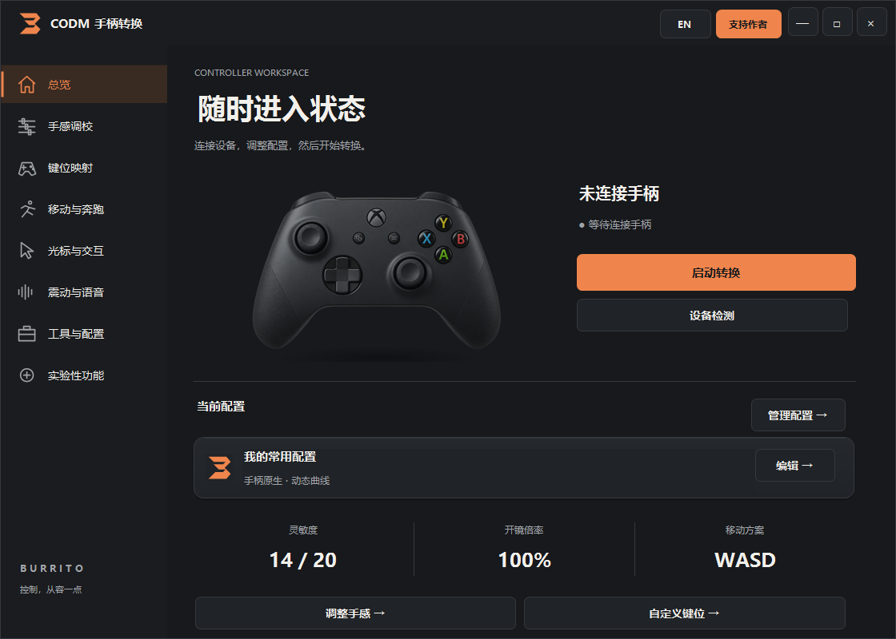

# CODM 手柄转换器

让手柄连接、手感调校和键位设置更清楚、更顺手。

**v3.4.6 · 全部功能免费 · Windows x64**

v3.4.6 统一物理按键的来源和映射顺序，修复肩键 / 扳机交换与游戏动作改键混用后扳机失效的问题。冲突会在当前窗口列出旧用途，确认替换 / 交换后才应用；取消保留原设置。新增实验功能：一个手柄键对应两个自选键盘键，以及自选单键切光标并移到游戏客户区左上角。键盘或光标用途接管时，原手柄动作不会同时触发；修改按住的按键后需先松开再按。游戏窗口须同时匹配游戏进程和标题，交流群或浏览器中的 CODM 字样不会被误选。

947 项回归检查通过。本机已用国产 Xbox 协议 USB 手柄完成训练场测试：交换与重绑、冲突替换排他、单键键盘组合、单键切光标均由使用者确认正常；复用现有驱动升级无须重启。

v3.4.5 修复部分繁体中文及其他区域设置下的开始菜单快捷方式乱码：名称中的“转换”不再变成“??”，路径与目标使用 Unicode。若之前安装停在“无法保存快捷方式”，请正常退出转换器和游戏，使用本版安装包选择原安装目录重新安装，保留个人配置并补完组件。快捷方式因权限等原因创建失败时会明确显示警告、继续准备驱动，并提供从安装目录打开软件的方式；不把组件尚未就绪当作安装可用。
v3.4.3 修复了曲线编辑页反死区、横纵灵敏度滑块能移动但不生效的问题。调整现在会更新实时曲线并保存，切换摇杆、重新打开页面后也能继续调整；54 项回归检查通过。出厂腰射反死区为 24%，默认只启用 WASD；页面提示将游戏奔跑模式设为“长按奔跑”。已有个人配置保留，新建配置或恢复默认才采用这些出厂值。

v3.4.4 修复首次启动时把安装包误认为游戏进程的问题。诊断改为实时检查两项组件的实际接口，区分未安装、已安装待生效、等待重启和转换尚未启动；未开启隐藏或转换不会再被误报为未安装。安装完成后只有接口真正可用才显示“可以使用”，点击启动软件会关闭安装器。正常关闭主窗口只退出转换器，旧配置中的退出清理开关不再触发卸载；需要清理时请从“工具与配置”主动打开清理 / 卸载工具。按钮和卡片采用柔和圆角，按钮重绘时完整清除四角残留。

[下载最新版](https://github.com/AlanHelium/codm-controller/releases/latest) · [必看说明](必看%20README.TXT) · [源码构建](BUILD.md) · [反馈问题](https://github.com/AlanHelium/codm-controller/issues)

## 全部功能免费

这个版本取消 Pro、激活码和付费功能区分。键位映射、曲线调校、WASD 外圈奔跑、语音和震动等功能全部开放，赞赏不影响功能使用。设置在主窗口中切换，支持作者页面也不会打断游戏。

源码公开，欢迎阅读和反馈。代码与第三方资源的说明分别见 [资源与许可说明](LICENSE-NOTICE.md)。

## 支持作者：请我吃点东西

这个项目耗费了很多时间和精力。从不同手柄的适配、输入手感和键位映射，到界面、安装与卸载，很多问题都需要反复测试、一点点排查和打磨。

如果这个工具让你玩得更舒服，也愿意鼓励我继续维护，可以请我吃点东西：

| 一份心意 | 你可以这样支持 |
| --- | --- |
| 🥟 简单吃一顿 | 买一包速冻饺子 |
| 🍚 好好吃顿饭 | 来一份猪脚饭 |
| ☕ 吃饱再提提神 | 猪脚饭，再点一杯瑞幸 |

**扫下面原始赞赏码，自选金额就好。**这些档位只是表达心意，没有最低金额，也没有对应的功能权限。

不赞赏也能使用全部功能。谢谢每一位使用、反馈、分享和支持这个项目的人。

## 选择适合你的分发方式

- **安装版**：选择安装位置，查看系统组件说明，包含卸载程序、必看说明和赞赏码图片。
- **免安装压缩包**：解压使用主程序，配套提供组件准备与清理工具。系统驱动仍需管理员权限；不能仅靠删除文件夹清理驱动和用户配置。

下载放在本仓库 Releases，附版本说明和 SHA256 校验文件；不要把 GitHub 自动生成的“Source code.zip”当作可直接运行的软件。

| 下载文件 | 用途 |
| --- | --- |
| CODMController-v3.4.6-Setup.exe | 推荐：安装版，选择安装位置，包含开始菜单与系统卸载入口 |
| CODMController-v3.4.6-Portable.zip | 免安装版，解压后先运行“准备组件.cmd”，再启动主程序；清理运行“清理卸载.cmd” |
| CODMController-v3.4.6-Source.zip | 源码版，阅读和本地构建，不能直接当作应用运行 |

下载页另附 `README-Important.txt`（必看说明）、`Donation.png`（赞赏码）和 `SHA256.txt`。安装或解压后，说明与赞赏图片使用中文名称。

两套软件使用相同输入核心。安装/组件准备会核验文件并安装或复用 ViGEmBus 与 HidHide；不会静默关闭安全防护。驱动是共享系统组件，卸载时可自行选择保留。界面会区分清理成功、保留项、失败与等待重启；需要重启时由你选择时机。

## 使用前必看

1. 先退出游戏和旧转换器，再准备组件；建议先用 USB 数据线测试。
2. 先启动转换、确认成功，再打开游戏进入训练场。
3. 使用 WASD 外圈奔跑时，先确认实体键盘 W＋左 Shift 能在游戏中正常奔跑。
4. 同时运行多个转换器或已打开的旧游戏，可能导致原始输入绕过映射。
5. ViGEmBus 和 HidHide 是共享系统组件。清理前可选择保留，界面会列出保留项。
6. 若显示待重启，说明清理还未完全生效。重启后须完成复查，不以“安排删除”代替“已清理”。

v3.4.1 已由使用者使用 DS5 USB 验证原生手感、跳跃/换弹交换和 WASD 外圈奔跑。v3.4.2 保留这套输入核心，免费功能检查与 DS5 真实隔离/映射交换/恢复检查通过；安装版升级与免安装准备/清理已实测。v3.4.3 修复滑块回调，不改动输入核心；本次未重新进行真实游戏或设备隔离测试。其他手柄、蓝牙和不同游戏环境仍需逐项验证，图片识别不代表全部游戏兼容。

免安装包第一次准备组件后会记录解压位置。准备后需要搬动目录时，先运行清理工具并按需保留共享驱动和配置，再从原始 ZIP 解压到新位置；不要只搬动带有维护记录的目录。

## 安全提示与使用说明

未签名应用、驱动安装或输入模拟可能触发系统或安全软件提示。请核验发布来源、SHA256 和检测结果，不要把所有提示都当作误报，也不要关闭系统防护。

本项目不是游戏官方产品；使用前请了解游戏与平台规则，并在允许的环境测试。兼容性、设备支持范围与已知问题以对应版本说明为准。

## 反馈问题

提交 Issue 时，请提供软件版本、手柄型号、USB/蓝牙方式、Windows/模拟器版本、操作步骤和实际现象。日志中有个人信息时请先去除；不要公开完整私人配置、授权记录或与问题无关的系统日志。
