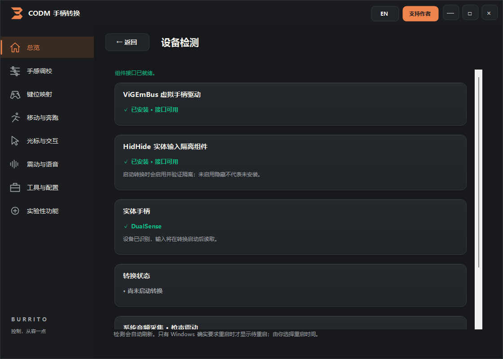

# 首次启动与维护

安装器核验文件、安装或复用 ViGEmBus 与 HidHide，并实际打开组件接口检查能否使用。显示“已安装”与“接口可用”是两个不同状态；组件确实要求重启时由用户选择时机。

设备检测会自动刷新，也可手动刷新。转换尚未启动、尚未读取输入、尚未启用隐藏或未请求音频采集，都不是组件未安装。

先退出游戏及模拟器，启动转换成功后再打开游戏。若检测到真实游戏或模拟器进程，状态说明会列出名称和 PID；安装器和清理工具自身不会再被当作游戏。

关闭主窗口只保存设置、停止转换和释放本次输入会话。需要卸载请从“工具与配置”主动打开清理 / 卸载工具，或使用系统卸载入口；清理范围和重启时间由用户选择。

全新机器首次安装内核驱动仍可能需要重新插拔手柄或重启；程序不会把待生效谎报为可用，也不会自动重启电脑。
